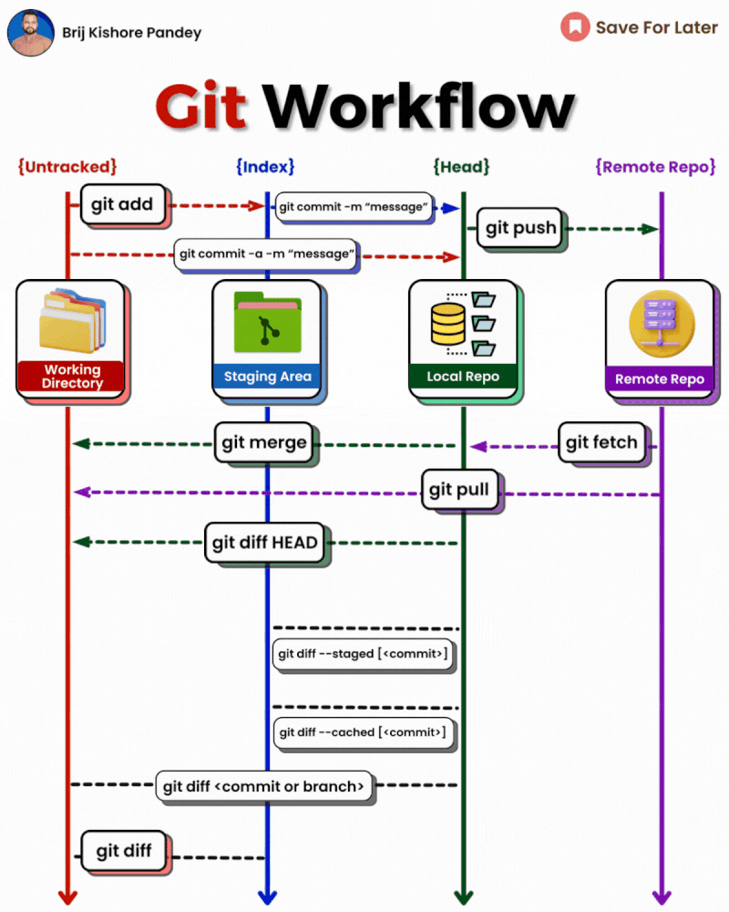
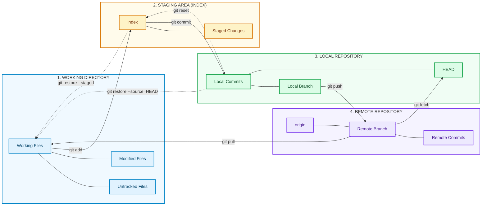
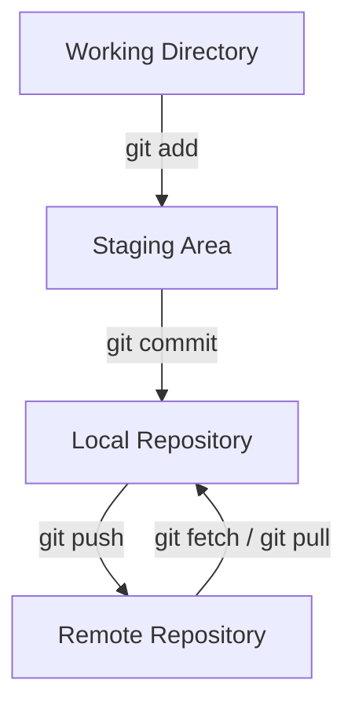

Git is a distributed version control system that tracks changes to files, helps developers maintain different lines of development, and enables collaboration through remote repositories such as GitHub, GitLab, and Bitbucket.

This cheatsheet covers the most common Git commands, from creating your first repository to collaborating with others, resolving conflicts, undoing mistakes, and recovering lost work.





## 1. Understanding the Git Workflow

A typical Git workflow moves changes through three main areas before they become part of the repository history.

- **Working directory:** Files you are currently editing.
- **Staging area:** Changes selected for the next commit.
- **Local repository:** Commits saved in your local Git history.
- **Remote repository:** A shared copy hosted on a service such as GitHub.



The most common workflow is:

```bash
git status
git add <file>
git commit -m "Describe the change"
git push
```

If the branch has no upstream configured yet, use `git push -u origin <branch>` instead of a plain `git push`.

## 2. Installing and Configuring Git

### Check the installed version

```bash
git --version
```

### Set your identity

Git records the configured name and email in your commits.

```bash
git config --global user.name "Your Name"
git config --global user.email "you@example.com"
```

Set these options without `--global` to configure them only for the current repository.

### Configure the default branch name

```bash
git config --global init.defaultBranch main
```

### Set your preferred editor

For Visual Studio Code:

```bash
git config --global core.editor "code --wait"
```

### View configuration

```bash
git config --list
git config --global --list
git config user.name
git config user.email
```

To see where a configuration value came from:

```bash
git config --show-origin --get user.name
```

### Change or remove configuration

```bash
git config --global user.email "new-email@example.com"
git config --global --unset user.email
```

## 3. Creating and Cloning Repositories

### Initialize a new repository

Run this inside the directory you want to track:

```bash
git init
```

Initialize a repository in a specific directory:

```bash
git init my-project
cd my-project
```

### Clone an existing repository

```bash
git clone <repository-url>
```

Clone into a directory with a custom name:

```bash
git clone <repository-url> my-project
```

Clone a specific branch:

```bash
git clone --branch <branch> --single-branch <repository-url>
```

### Check whether a directory is a Git repository

```bash
git rev-parse --is-inside-work-tree
```

Display the repository's root directory:

```bash
git rev-parse --show-toplevel
```

### View repository information

```bash
git status
git remote -v
git branch
git log --oneline
```

## 4. Working with Files and Changes

### Check repository status

```bash
git status
git status --short
```

The short output uses status codes to show whether files are modified, staged, untracked, or deleted.

### Stage changes

Stage one file:

```bash
git add <file>
```

Stage a directory:

```bash
git add <directory>/
```

Stage all changes in the current directory and its subdirectories:

```bash
git add .
```

Stage all tracked modifications and deletions, but not new untracked files:

```bash
git add -u
```

Interactively select changes to stage:

```bash
git add -p
```

Interactive staging is useful when one file contains multiple unrelated changes that should be committed separately.

### Unstage a file

Keep the file changes but remove them from the staging area:

```bash
git restore --staged <file>
```

Unstage everything:

```bash
git restore --staged .
```

### Discard unstaged changes

Restore a tracked file to its version in the index:

```bash
git restore <file>
```

Discard all unstaged changes to tracked files:

```bash
git restore .
```

**Warning:** Restoring files this way discards their unstaged modifications. Save a backup or stash changes you may need.

### Stop tracking a file without deleting it

```bash
git rm --cached <file>
```

For a directory:

```bash
git rm -r --cached <directory>/
```

This is useful after adding a path to `.gitignore`. It does not remove the file from previous commits.

### Delete a tracked file

```bash
git rm <file>
git commit -m "Remove obsolete file"
```

## 5. Committing Changes

### Create a commit

```bash
git commit -m "Add network configuration guide"
```

### Stage tracked changes and commit them

```bash
git commit -am "Fix configuration examples"
```

The `-a` option automatically stages modifications and deletions of tracked files. It does not include newly created, untracked files.

### Write a longer commit message

```bash
git commit
```

Git opens your configured editor for the commit message.

### Amend the latest commit

Change the latest commit message:

```bash
git commit --amend -m "Correct commit message"
```

Include additional staged changes in the latest commit:

```bash
git add <file>
git commit --amend --no-edit
```

**Important:** Amending rewrites the latest commit. Avoid amending commits already shared with others unless you understand the consequences and have coordinated the history change.

### Review the staged changes before committing

```bash
git diff --cached
```

Review unstaged changes:

```bash
git diff
```

## 6. Branching and Switching Branches

Branches let you develop features or fix bugs without making changes directly on another line of development.

### List branches

```bash
git branch
```

List local and remote-tracking branches:

```bash
git branch -a
```

Show the current branch:

```bash
git branch --show-current
```

### Create a branch

```bash
git branch <branch-name>
```

Create and switch to a new branch:

```bash
git switch -c <branch-name>
```

Example:

```bash
git switch -c feature/network-guide
```

### Switch branches

```bash
git switch main
```

The older equivalent is:

```bash
git checkout main
```

### Rename a branch

Rename the current branch:

```bash
git branch -m <new-name>
```

Rename another local branch:

```bash
git branch -m <old-name> <new-name>
```

### Delete a local branch

Delete a branch that Git considers safely merged:

```bash
git branch -d <branch-name>
```

Force-delete a local branch:

```bash
git branch -D <branch-name>
```

**Warning:** Force deletion can discard the branch's only reference to unmerged commits.

## 7. Working with Remote Repositories

A remote is a named reference to another Git repository. `origin` is the conventional name for the remote created when cloning.

### List configured remotes

```bash
git remote -v
```

### Add a remote

```bash
git remote add origin <repository-url>
```

### Change a remote URL

```bash
git remote set-url origin <repository-url>
```

### Rename a remote

```bash
git remote rename origin upstream
```

### Remove a remote

```bash
git remote remove <remote-name>
```

Removing a remote deletes its local configuration, not the remote repository itself.

### Fetch remote changes

Fetch from a particular remote:

```bash
git fetch origin
```

Fetch updates for all configured remotes:

```bash
git fetch --all
```

Fetch and prune remote-tracking branches that no longer exist remotely:

```bash
git fetch --prune origin
```

Fetching downloads commits and updates remote-tracking references without merging changes into your current branch.

### Pull changes

Pull the current branch from its configured upstream:

```bash
git pull
```

Pull a specific remote branch:

```bash
git pull origin main
```

Rebase local commits on top of the fetched branch:

```bash
git pull --rebase origin main
```

Use a merge-based or rebase-based pull according to your team's workflow. Check your working tree before pulling, and commit or stash work when necessary.

### Push changes

Push the current branch to a remote:

```bash
git push origin <branch-name>
```

Set the upstream branch on the first push:

```bash
git push -u origin <branch-name>
```

Once the upstream is configured, later pushes usually need only:

```bash
git push
```

### Push a new branch

```bash
git switch -c feature/new-feature
git add .
git commit -m "Add new feature"
git push -u origin feature/new-feature
```

### Delete a remote branch

```bash
git push origin --delete <branch-name>
```

This deletes the branch on the remote. It does not automatically delete your local branch.

## 8. Merging Branches

Merging incorporates changes from another branch into the current branch.

### Merge a branch into the current branch

```bash
git switch main
git merge feature/network-guide
```

### Create a merge commit when possible

```bash
git merge --no-ff feature/network-guide
```

This preserves a merge commit even when a fast-forward merge would otherwise be possible.

### Abort a merge in progress

```bash
git merge --abort
```

Use this when a merge is in progress and you want to return to the pre-merge state. If you made additional changes during conflict resolution, review them before aborting.

### Delete the merged branch

```bash
git branch -d feature/network-guide
```

## 9. Rebasing Branches

Rebase replays commits on top of another commit, creating a linear history in many common workflows.

### Rebase the current branch onto main

```bash
git fetch origin
git rebase origin/main
```

### Rebase onto a local branch

```bash
git rebase main
```

### Continue after resolving conflicts

```bash
git add <resolved-file>
git rebase --continue
```

Repeat as needed until the rebase finishes.

### Skip a problematic commit

```bash
git rebase --skip
```

Only skip a commit if you intend to omit its changes.

### Abort a rebase

```bash
git rebase --abort
```

**Important:** Rebasing changes commit history. Avoid rebasing commits other people are already using unless your team has agreed on that workflow. If you must push rewritten history, prefer `--force-with-lease` over `--force`.

## 10. Resolving Merge Conflicts

A conflict occurs when Git cannot automatically reconcile competing changes.

### Identify conflicted files

```bash
git status
```

Open each conflicted file and look for markers like these:

```text
<<<<<<< HEAD
Your current branch's changes
=======
Incoming branch's changes
>>>>>>> feature-branch
```

Edit the file to retain the intended result and remove the conflict markers.

### Mark a conflict as resolved

```bash
git add <resolved-file>
```

Finish a merge:

```bash
git commit
```

Finish a rebase instead:

```bash
git rebase --continue
```

The correct finishing command depends on whether the conflict occurred during a merge or rebase.

### Compare the competing changes

```bash
git diff
git diff --ours -- <file>
git diff --theirs -- <file>
```

During a merge, `--ours` refers to the current branch and `--theirs` to the branch being merged. During a rebase, those labels can be counterintuitive because commits are replayed onto a new base.

### Choose one side of a conflicted file

```bash
git checkout --ours -- <file>
git checkout --theirs -- <file>
```

These commands replace the file's working-tree contents with the chosen side. Review the result before staging it. The newer `git restore` command can also be used, but be particularly careful when resolving conflicts during a rebase.

## 11. Reviewing Commit History

### Show commit history

```bash
git log
```

Compact history:

```bash
git log --oneline
```

Graphical history with branches and merges:

```bash
git log --oneline --graph --decorate --all
```

Show the most recent five commits:

```bash
git log -5 --oneline
```

Show commits from a particular author:

```bash
git log --author="Ajay Singh"
```

Show commits since a date:

```bash
git log --since="2026-01-01"
```

### Search commit messages

```bash
git log --grep="network"
```

Search case-insensitively:

```bash
git log --grep="network" -i
```

### Show a specific commit

```bash
git show <commit>
```

Show only the changed file names:

```bash
git show --stat <commit>
```

Show commit details and the patch for a file:

```bash
git show <commit> -- <file>
```

### Compare changes

Compare the working directory with the staging area:

```bash
git diff
```

Compare staged changes with the latest commit:

```bash
git diff --cached
```

Compare two branches:

```bash
git diff main..feature/network-guide
```

Compare the tips of two branches directly:

```bash
git diff main feature/network-guide
```

Compare the changes introduced by a branch since it diverged from main:

```bash
git diff main...feature/network-guide
```

The two-dot and three-dot forms have different meanings. The three-dot form compares the merge base with the second branch, which is often useful when reviewing a feature branch.

### Find who changed a line

```bash
git blame <file>
```

Limit the output to a line range:

```bash
git blame -L 20,40 -- <file>
```

## 12. Undoing Changes Safely

Different Git commands undo changes in different places. Choose the command based on whether the change is uncommitted, staged, or already committed.

### Unstage changes without discarding them

```bash
git restore --staged <file>
```

### Discard unstaged changes to a tracked file

```bash
git restore <file>
```

### Undo a commit by creating a new commit

```bash
git revert <commit>
```

This is usually the safest approach for undoing changes that have already been pushed or shared because it preserves the existing history.

### Move the current branch pointer back one commit

```bash
git reset --soft HEAD~1
```

The commit is removed from the current branch history, but its changes remain staged.

Keep the changes but unstage them:

```bash
git reset --mixed HEAD~1
```

`--mixed` is the default reset mode.

### Hard reset to a commit

```bash
git reset --hard <commit>
```

**Danger:** This moves the current branch to the specified commit and discards tracked working-tree and index changes. Uncommitted work can be permanently lost. It does not remove untracked files.

Before resetting, consider creating a backup branch:

```bash
git branch backup-before-reset
```

### Undo a pushed commit

For a shared branch, prefer:

```bash
git revert <commit>
git push
```

Rewriting a published branch with `reset` and a force push can disrupt collaborators. Use history rewriting only when it is appropriate for the repository and coordinated with everyone affected.

## 13. Stashing Temporary Changes

Stash temporarily saves working changes so you can switch tasks without creating a commit.

### Save tracked changes

```bash
git stash
```

Include untracked files:

```bash
git stash -u
```

Include ignored files too:

```bash
git stash -a
```

Use `-a` cautiously because it can save build output, local secrets, and other ignored files.

### List stashes

```bash
git stash list
```

### View a stash

```bash
git stash show
git stash show -p stash@{0}
```

### Apply a stash and keep it in the stash list

```bash
git stash apply
```

Apply a particular stash:

```bash
git stash apply stash@{0}
```

### Apply and remove the stash entry

```bash
git stash pop
```

### Delete a stash

```bash
git stash drop stash@{0}
```

Delete all stashes:

```bash
git stash clear
```

**Warning:** `git stash clear` removes all stash entries. Do not use it if you may need those changes later.

## 14. Tags and Releases

Tags identify important points in repository history, such as releases.

### List tags

```bash
git tag
```

### Create a lightweight tag

```bash
git tag v1.0.0
```

### Create an annotated tag

```bash
git tag -a v1.0.0 -m "Release version 1.0.0"
```

Annotated tags store metadata and are generally preferable for releases.

### Tag a specific commit

```bash
git tag -a v1.0.0 <commit> -m "Release version 1.0.0"
```

### Inspect a tag

```bash
git show v1.0.0
```

### Push a tag

```bash
git push origin v1.0.0
```

Push all local tags:

```bash
git push origin --tags
```

### Delete a local or remote tag

```bash
git tag -d v1.0.0
git push origin --delete v1.0.0
```

Deleting a remote tag affects other users and may disrupt release processes. Coordinate before removing published release tags.

## 15. Cherry-Picking Commits

Cherry-picking applies the changes from a particular commit to your current branch.

### Apply a commit

```bash
git switch main
git cherry-pick <commit>
```

### Apply several commits

```bash
git cherry-pick <commit-1> <commit-2>
```

### Continue after resolving conflicts

```bash
git add <resolved-file>
git cherry-pick --continue
```

### Abort cherry-picking

```bash
git cherry-pick --abort
```

Cherry-picking creates a new commit on the current branch. The original commit remains in its original history.

## 16. Cleaning Untracked Files

Untracked files are files Git does not currently track. They may include temporary files, generated output, or new source files.

### Preview files that would be deleted

```bash
git clean -n
```

Preview untracked files and directories:

```bash
git clean -nd
```

### Delete untracked files

```bash
git clean -f
```

Delete untracked files and directories:

```bash
git clean -fd
```

Include ignored files in the cleanup:

```bash
git clean -fdX
```

Delete both ignored and untracked files:

```bash
git clean -fdx
```

**Warning:** `git clean` deletes files from the working directory. Use the dry-run option (`-n`) first, especially before using `-fdx`, which can delete ignored build artifacts, local configuration files, and other files that are not stored in Git.

## 17. Searching Git History and Files

### Search commit messages

```bash
git log --grep="authentication"
```

### Search the contents of tracked files

```bash
git grep "TODO"
```

Search a specific directory:

```bash
git grep "TODO" -- app/
```

Search the contents of a specific commit:

```bash
git grep "TODO" <commit>
```

### Find commits that changed a particular file

```bash
git log --follow -- <file>
```

The `--follow` option is useful for tracing a file across renames, although it has limitations with complex histories.

### Find when a string was added or removed

```bash
git log -S"functionName" --all
```

For a regular-expression search across changed lines:

```bash
git log -G"functionName" --all
```

## 18. Recovering Lost Commits

Git maintains a reference log of recent movements of local branch and reference pointers. It can help recover commits after accidental resets, rebases, or branch changes.

### Inspect the reflog

```bash
git reflog
```

Inspect the reflog for a specific branch:

```bash
git reflog show main
```

### Restore a previous state safely

Find the commit you want to recover, then create a backup branch at that commit:

```bash
git branch recovery-branch <commit>
```

Inspect the recovered work:

```bash
git switch recovery-branch
git log --oneline -10
```

If you only need to restore a specific commit's changes, consider cherry-picking it onto the intended branch.

Reflog entries are local and expire over time. They are not a substitute for backups, and they do not guarantee recovery of every lost or uncommitted change.

## 19. Working with `.gitignore`

A `.gitignore` file tells Git which untracked paths to ignore.

Example:

```gitignore
# Dependencies
node_modules/

# Build output
dist/
build/
.next/

# Environment files
.env
.env.*
!.env.example

# Logs
*.log

# Editor and operating system files
.DS_Store
Thumbs.db
```

Adjust these patterns for your project. For example, some projects intentionally track selected environment files or generated output.

### Check whether a path is ignored

```bash
git check-ignore -v <path>
```

### Apply `.gitignore` to a file already tracked by Git

Adding a file to `.gitignore` does not stop tracking it if it has already been committed.

```bash
git rm --cached <file>
git add .gitignore
git commit -m "Stop tracking ignored file"
```

For a directory, use `git rm -r --cached <directory>/` instead.

**Security note:** If you accidentally commit a password, API token, or private key, removing the file in a later commit does not remove the secret from repository history. Revoke or rotate the exposed credential immediately, then follow the hosting provider's procedure for removing sensitive data from history if necessary.

## 20. Common Collaboration Workflows

### Workflow A: Start a feature branch and push it

```bash
git switch main
git pull --ff-only origin main
git switch -c feature/new-feature

# Make changes
git status
git add <files>
git commit -m "Add new feature"

git push -u origin feature/new-feature
```

Create a pull request or merge request through your hosting platform.

### Workflow B: Update a feature branch with main

```bash
git fetch origin
git switch feature/new-feature
git rebase origin/main
```

Resolve any conflicts and continue the rebase as needed. Then push:

```bash
git push
```

If the branch was already pushed and the rebase rewrote its commits, a normal push may be rejected. If rewriting the branch is intended and coordinated, use:

```bash
git push --force-with-lease
```

`--force-with-lease` checks the expected remote reference before updating it, but it is not a replacement for coordinating changes with collaborators.

### Workflow C: Commit and push a quick fix

```bash
git status
git add <files>
git commit -m "Fix network configuration example"
git push
```

### Workflow D: Sync a local main branch without creating a merge commit

```bash
git switch main
git fetch origin
git pull --ff-only origin main
```

The `--ff-only` option refuses to create a merge commit when local and remote histories have diverged.

### Workflow E: Undo a published change

```bash
git log --oneline
git revert <commit>
git push
```

Use this workflow when you want to reverse a published commit without rewriting shared history.

## 21. Troubleshooting Common Git Problems

### Error: `fatal: not a git repository`

Check your current directory:

```bash
pwd
git rev-parse --show-toplevel
```

Navigate to the project root or initialize the repository if appropriate.

### Error: `remote origin already exists`

Inspect existing remotes:

```bash
git remote -v
```

Update the existing URL:

```bash
git remote set-url origin <repository-url>
```

### Error: `rejected (non-fast-forward)`

Fetch the latest changes and integrate them before pushing:

```bash
git fetch origin
git pull --rebase origin <branch>
git push
```

Resolve any conflicts before continuing.

### Error: `nothing to commit`

Check the current status:

```bash
git status
```

Your changes may already be committed, may be ignored, or may not have been saved to disk.

### Check the upstream branch

```bash
git branch -vv
```

Set an upstream if needed:

```bash
git branch --set-upstream-to=origin/main main
```

### Check the configured remote URL

```bash
git remote get-url origin
```

If authentication fails, verify the URL, account access, and configured SSH key or credential manager. Avoid putting access tokens directly in remote URLs or shell history.

## 22. Quick Reference

| Task | Command |
| --- | --- |
| Check status | `git status` |
| Initialize repository | `git init` |
| Clone repository | `git clone <url>` |
| Stage a file | `git add <file>` |
| Commit staged changes | `git commit -m "message"` |
| Create and switch branch | `git switch -c <branch>` |
| Switch branch | `git switch <branch>` |
| List branches | `git branch -a` |
| Fetch remote changes | `git fetch origin` |
| Pull changes | `git pull` |
| Push current branch | `git push` |
| Set upstream and push | `git push -u origin <branch>` |
| Merge a branch | `git merge <branch>` |
| Rebase onto main | `git rebase main` |
| Show compact history | `git log --oneline --graph --all` |
| Compare working changes | `git diff` |
| Compare staged changes | `git diff --cached` |
| Unstage a file | `git restore --staged <file>` |
| Discard unstaged changes | `git restore <file>` |
| Revert a commit | `git revert <commit>` |
| Stash changes | `git stash -u` |
| Apply latest stash | `git stash pop` |
| Create annotated tag | `git tag -a <tag> -m "message"` |
| Preview cleanup | `git clean -nd` |
| Inspect recent reference history | `git reflog` |

## 23. Git Best Practices

- Check `git status` before staging, committing, switching branches, or cleaning files.
- Write clear commit messages that explain the purpose of a change.
- Keep commits focused on one logical task.
- Review staged changes with `git diff --cached` before committing.
- Use feature branches and pull requests for collaborative development.
- Fetch and integrate remote changes before pushing when necessary.
- Prefer `git revert` for undoing changes on shared branches.
- Avoid `git reset --hard`, `git clean -fd`, and force pushes unless you understand their effects.
- Never commit passwords, private keys, or access tokens.
- Use annotated tags for releases and preserve release history.
- Back up important work; local Git history and reflogs are not complete backups.

Git provides many more commands for specialized workflows, but the commands in this cheatsheet cover most everyday development and collaboration tasks. When in doubt, inspect the repository state first and choose the least destructive command that achieves your goal.
