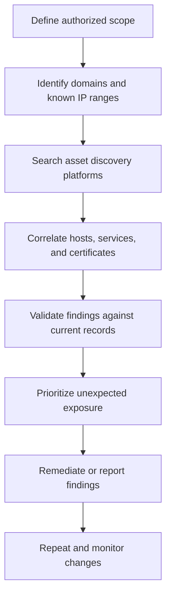

Internet asset search engines collect and index information about publicly reachable systems, network services, certificates, and internet-connected devices. Security professionals use them for attack surface management, threat intelligence, vulnerability research, and authorized security assessments.

Unlike traditional search engines, which primarily index web pages, these platforms can provide information about service banners, open ports, software fingerprints, TLS certificates, and other technical attributes of internet-facing infrastructure.

Use these tools to investigate systems you own, administer, or have explicit permission to assess. Search results are snapshots of collected data, not proof that a system is currently accessible or vulnerable.

## 1. Shodan

**Website:** [https://www.shodan.io/](https://www.shodan.io/)

Shodan indexes information collected from internet-connected devices and services. It is commonly used to discover exposed servers, network appliances, industrial systems, cameras, and other internet-facing services.

### Common use cases

- Identify publicly exposed services associated with your organization.
- Review service banners, detected software, and open ports.
- Find internet-facing devices that may require configuration changes.
- Monitor the exposure of your own infrastructure.

### Example searches

Find results associated with a specific hostname:

```text
hostname:example.com
```

Search for a particular port on systems you are authorized to assess:

```text
hostname:example.com port:443
```

Search for a specific organization:

```text
org:"Example Organization"
```

These examples use Shodan's search-filter syntax. Results depend on the platform's indexed data and your account access.

**Documentation:** [Shodan Search Query Fundamentals](https://help.shodan.io/the-basics/search-query-fundamentals)

## 2. Censys

**Website:** [https://search.censys.io/](https://search.censys.io/)

Censys provides internet asset discovery and security intelligence based on observed hosts, services, web properties, and digital certificates.

It is particularly useful for understanding how infrastructure is exposed across IP addresses, domains, and TLS certificates.

### Common use cases

- Discover hosts associated with your organization's infrastructure.
- Investigate TLS certificates and certificate relationships.
- Identify exposed services and software fingerprints.
- Support attack surface management and threat research.

### Example searches

Search for a domain in certificate or host data:

```text
example.com
```

Search for hosts exposing SSH on port 22:

```text
host.services: (port = "22" and protocol = "SSH")
```

Censys has multiple search experiences and query languages. Confirm which interface you are using before copying a query, because supported fields and syntax can differ.

**Documentation:** [Censys Query Language](https://docs.censys.com/docs/censys-query-language)

## 3. ZoomEye

**Website:** [https://www.zoomeye.ai/](https://www.zoomeye.ai/)

ZoomEye is an internet asset search engine for discovering hosts, services, and internet-connected technologies. It can help researchers investigate exposed infrastructure and identify technologies present on publicly reachable systems.

### Common use cases

- Discover internet-facing hosts and services.
- Investigate IoT and network infrastructure exposure.
- Research industrial and other specialized systems.
- Examine technologies and service fingerprints.

### Example search

Search for a hostname or domain associated with an authorized assessment:

```text
hostname="example.com"
```

ZoomEye supports its own search syntax. Check its current query documentation for supported fields and operators.

**Website:** [ZoomEye](https://www.zoomeye.ai/)

## 4. FOFA

**Website:** [https://fofa.info/](https://fofa.info/)

FOFA is a cyberspace asset search engine that indexes information about internet-facing hosts, applications, and services.

It is used for asset discovery, technology research, and security analysis. Its search language provides filters for narrowing results to specific assets or characteristics.

### Common use cases

- Discover publicly exposed applications belonging to an organization.
- Investigate internet-facing web services.
- Search for technology and service fingerprints.
- Research an organization's potential external attack surface.

### Example search

A hostname-focused search may look like:

```text
domain="example.com"
```

Check the current FOFA documentation for exact syntax, available fields, and account-specific capabilities.

**Website:** [FOFA](https://fofa.info/)

## 5. Netlas

**Website:** [https://netlas.io/](https://netlas.io/)

Netlas provides internet asset search and technical data that can help researchers investigate hosts, domains, network services, and certificates.

It is useful when you want another source of evidence to compare with Shodan, Censys, or other asset discovery platforms.

### Common use cases

- Investigate exposed network services.
- Search for hosts and domains related to an organization.
- Examine certificates and service metadata.
- Support security research and external asset inventory.

### Example search

Start with a domain or hostname associated with your authorized assessment:

```text
example.com
```

Then narrow the results using the fields supported by Netlas's current search interface.

**Website:** [Netlas](https://netlas.io/)

## 6. LeakIX

**Website:** [https://leakix.net/](https://leakix.net/)

LeakIX focuses on identifying and indexing exposed services and security-relevant observations. Depending on the data available, results may include misconfigured services, publicly accessible data stores, and other potentially sensitive exposures.

### Common use cases

- Audit your own public-facing services for unintended exposure.
- Investigate suspected configuration mistakes.
- Monitor internet-facing infrastructure for security issues.
- Research historical observations of exposed services.

### Responsible use

A search result may describe a historical observation or a potential exposure rather than a confirmed current vulnerability. Do not attempt to access, download, or modify another party's private data.

If you discover exposed data belonging to someone else, follow the service owner's responsible disclosure process.

**Website:** [LeakIX](https://leakix.net/)

## 7. BinaryEdge

**Website:** [https://www.binaryedge.io/](https://www.binaryedge.io/)

BinaryEdge has been known for internet-wide scanning, infrastructure visibility, and cyber threat intelligence. Its availability, product scope, and search capabilities may change, so verify the current service offerings before relying on it.

### Potential use cases

- Internet-facing asset discovery.
- Infrastructure and service exposure research.
- Threat intelligence and security monitoring.
- Supporting an external attack surface inventory.

When researching an organization, compare results with current DNS records, cloud inventories, and other authoritative sources. A third-party scan alone should not be treated as a definitive asset inventory.

## 8. ONYPHE

**Website:** [https://www.onyphe.io/](https://www.onyphe.io/)

ONYPHE is a cyber defense search engine that collects and organizes information about internet-facing assets. Its search model supports investigations involving IP addresses, IP ranges, domains, subdomains, and other related observations.

### Common use cases

- Map assets associated with an organization.
- Investigate IP addresses and network ranges.
- Search for related domains and subdomains.
- Correlate technical observations during threat intelligence research.

### Example searches

Search for a domain:

```text
domain:example.com
```

Search for a specific IP address:

```text
ip:192.0.2.10
```

Search for a documentation-only IP range:

```text
ip:192.0.2.0/24
```

The IP addresses above are examples from the ranges reserved for documentation; replace them with assets you are authorized to investigate.

**Documentation:** [ONYPHE Getting Started](https://search.onyphe.io/docs/getting-started)

## 9. CrimeFlare and Cloudflare Origin-IP Research

CrimeFlare has historically been associated with research into identifying origin IP addresses behind Cloudflare-proxied websites.

**Important:** Treat CrimeFlare as a historical reference, not as a guaranteed current service or a reliable method for discovering an origin server. A site's origin IP may not be publicly discoverable, and historical records may be stale or incorrect.

### For authorized infrastructure investigations

If you administer the domain, use your own infrastructure records first:

- Check the DNS records configured in your authoritative DNS provider.
- Review your hosting or cloud provider's assigned public IP addresses.
- Inspect your reverse-proxy, firewall, and load-balancer configuration.
- Verify that the origin server accepts traffic only from intended sources.

Cloudflare proxying does not eliminate the need to secure an origin server. Origin access restrictions should be configured and tested independently.

**Cloudflare documentation:** [https://developers.cloudflare.com/](https://developers.cloudflare.com/)

## 10. IVRE Search

**Website:** [https://ivre.rocks/](https://ivre.rocks/)

IVRE is an open-source framework for gathering, processing, storing, and exploring network reconnaissance data. It can be used to build a searchable repository of network scan results.

Unlike hosted search engines that provide a ready-made global dataset, IVRE can be deployed for your own authorized scanning and analysis workflows.

### Common use cases

- Store and query network scan results.
- Build an internal asset discovery platform.
- Track changes in your own network exposure.
- Analyze authorized reconnaissance data over time.

### Typical workflow

1. Collect scan data from systems and networks you are permitted to assess.
2. Import the results into an IVRE deployment.
3. Query the stored data through its supported interface.
4. Compare observations over time to identify unexpected changes.

IVRE is particularly useful for teams that want more control over where scan data is stored and how it is analyzed.

**Project:** [IVRE on GitHub](https://github.com/ivre/ivre)

## 11. Choosing the Right Search Engine

Different platforms index different data and use different search languages. No single service provides a complete or perfectly current picture of the internet.

| Tool | Primary focus | Useful for |
| --- | --- | --- |
| Shodan | Internet-connected devices and services | Service exposure and device discovery |
| Censys | Hosts, web properties, and certificates | Infrastructure and certificate research |
| ZoomEye | Internet assets and service fingerprints | Host and technology discovery |
| FOFA | Cyberspace assets and applications | Asset search and technology research |
| Netlas | Internet asset and technical data search | Cross-checking hosts and services |
| LeakIX | Exposed services and security observations | Misconfiguration and exposure research |
| BinaryEdge | Internet scanning and threat intelligence | Infrastructure visibility, subject to current availability |
| ONYPHE | Cyber defense and asset intelligence | Domain, IP, and infrastructure investigations |
| CrimeFlare | Historical origin-IP research | Reference only; not a reliable general-purpose discovery method |
| IVRE | Self-hosted network reconnaissance data | Internal scanning and custom asset analysis |

## 12. A Practical OSINT Workflow

When investigating an organization you own or are authorized to assess, combine passive research with validation from authoritative sources.



### Step 1: Define the scope

Document the domains, IP ranges, cloud accounts, and third-party systems included in the assessment. Obtain permission before actively probing systems.

### Step 2: Gather passive information

Search for known domains, certificate records, hostnames, and publicly indexed services. Keep a record of the platform, search query, timestamp, and returned evidence.

### Step 3: Correlate findings

Compare observations across multiple services. Similar records from different sources can increase confidence, but duplicated or outdated data can create false confidence.

### Step 4: Validate the results

Confirm current DNS records, service availability, software versions, and ownership through authorized administrative access. A search engine's report does not automatically prove that a service remains exposed.

### Step 5: Prioritize and remediate

Focus on unnecessary public services, exposed administration interfaces, outdated software, unintended data exposure, and access controls that do not match your security requirements.

### Step 6: Monitor changes

Repeat the inventory periodically and compare results. New assets, unexpected ports, and changes in certificates or service fingerprints can help identify configuration drift.

## 13. Important Limitations and Safety Notes

- **Data freshness:** Scan results can be delayed, incomplete, or outdated.
- **False positives:** Service fingerprints do not always identify the correct software or version.
- **Coverage:** Platforms scan different portions of the internet and index different fields.
- **Access restrictions:** Some results, filters, APIs, and historical data may require an account or paid subscription.
- **Privacy:** Publicly indexed does not mean that accessing or redistributing the underlying data is appropriate.
- **Authorization:** Use discovery results to secure your own infrastructure or conduct assessments within an explicitly authorized scope.
- **Active testing:** Searching a database is not the same as probing a target. Confirm authorization before conducting port scans, exploitation attempts, or other active tests.

These services are best treated as sources of investigative leads. Combine their observations with current infrastructure records and authorized validation before making security decisions.
